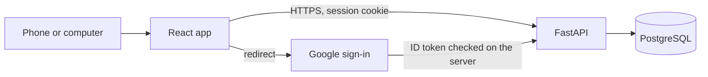

# Architecture

The browser never calculates the outstanding total that gets stored. It can preview a form, and the server recomputes remaining due, totals, and days remaining from the database and the clock.

Google's token is checked on the server. The session secret stays on the server. The allowlisted email is server configuration, not a value shipped in the frontend.

There is no payment service and no messaging service in this diagram. Those are omitted on purpose.

## First screen motion

The static prototype in `index.html` is the motion reference. Six cards travel a shallow ellipse, the front card larger, the others smaller and tilted. Outstanding is the ink card. Hover pauses the turn. `prefers-reduced-motion` holds a fan. The React app keeps that behavior through Motion, and does not add a second looping animation on the figures.

## Pages, once the app exists

1. Sign-in, only after the email is known.
2. Home: outstanding, next due, then the card list.
3. Card: statements for that card.
4. Statement: payments and the form to record one.
5. Settings: theme, due-soon days, export.

Empty, loading, and error are part of each data page. A control that does not work yet is not shown.

## Threats

| Risk | Response |
| --- | --- |
| Someone else opens the app | One Google account, checked on the server |
| A secret lands in the JS bundle | No secrets in `VITE_` variables |
| A full card number is typed in | The field does not exist. Last four only, optional |
| Amounts drift | Integer paise, server-side Decimal |
| A recorded payment is mistaken for a transfer | Copy says the owner pays the issuer first |
| Production data in CI | Synthetic fixtures only |
| Deploy without review | Pull requests do not deploy. Production waits for a later approval |
